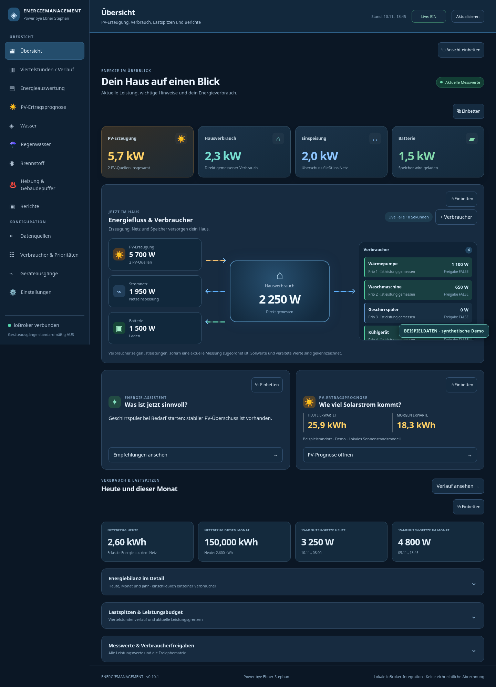
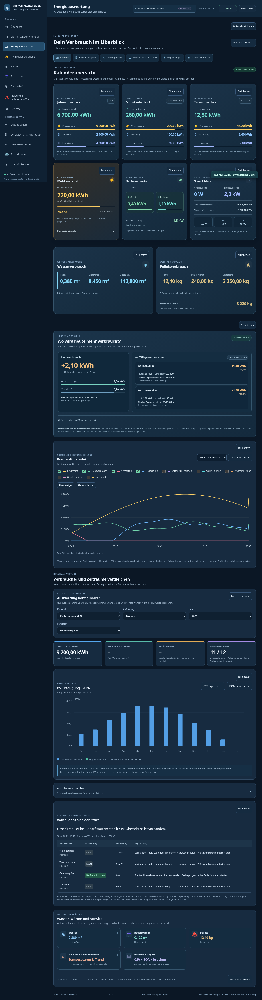
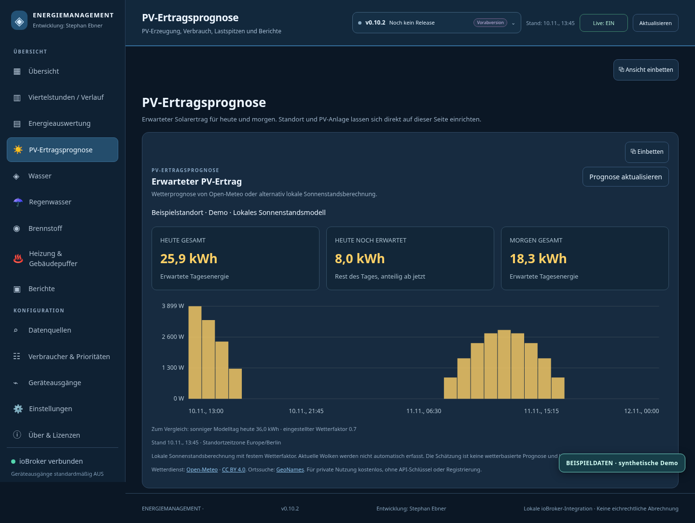
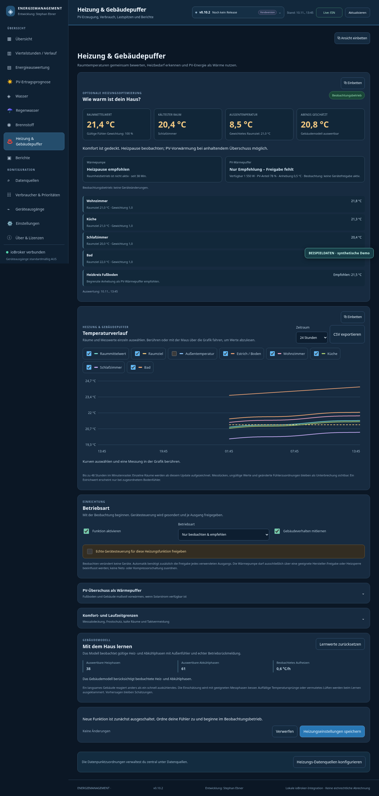
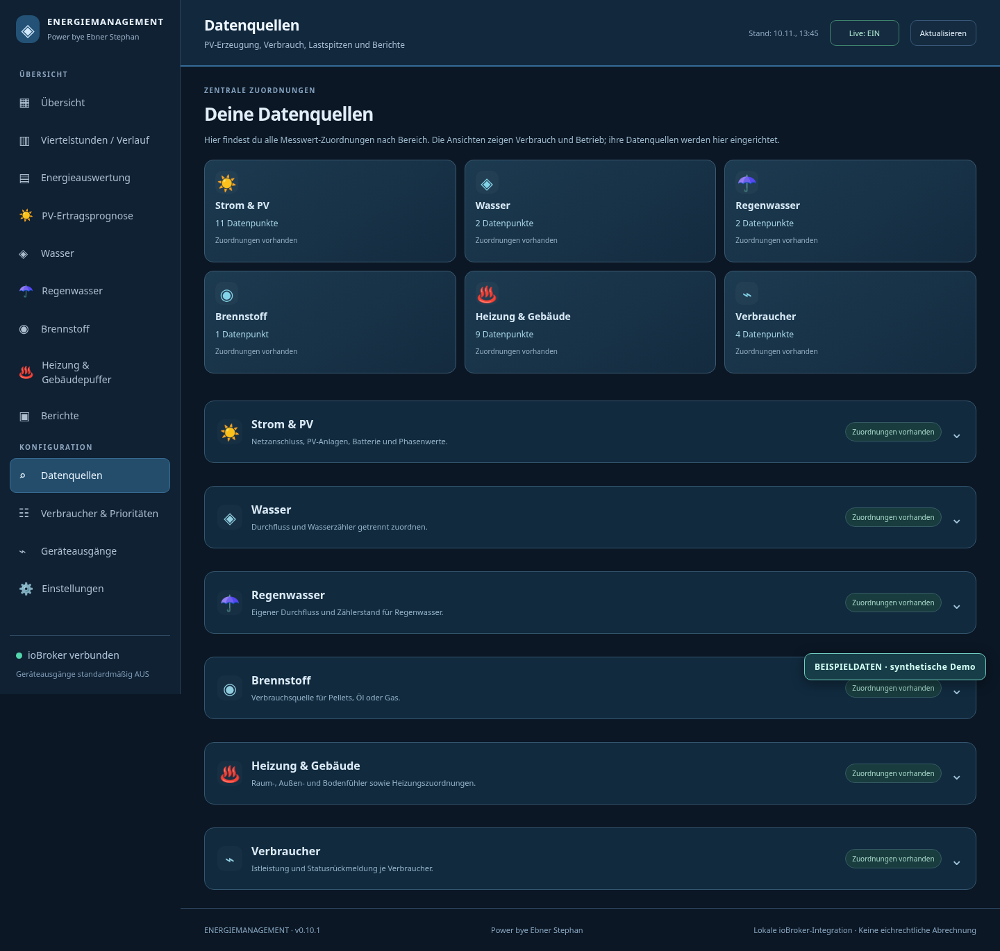
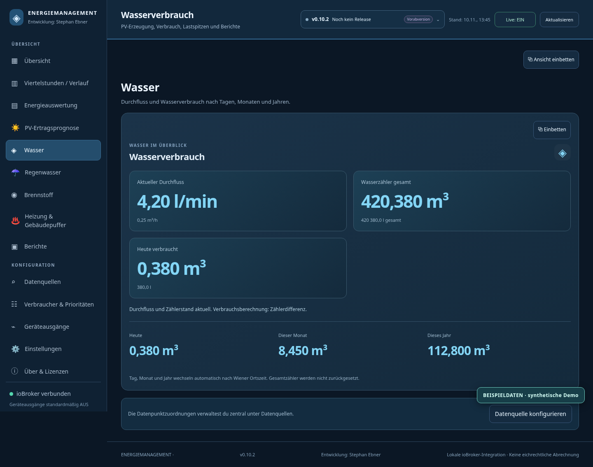
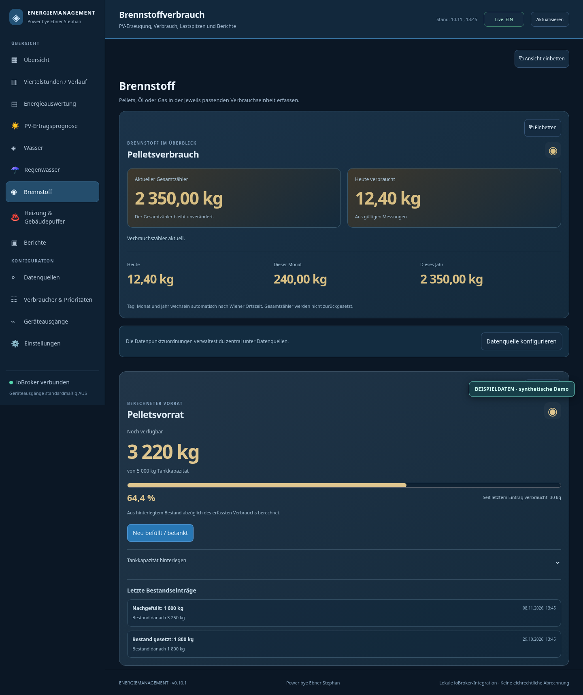
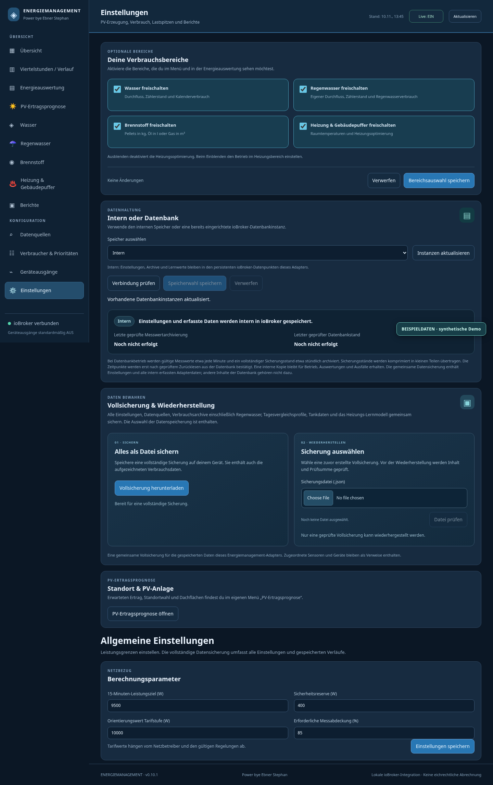

# ioBroker Energiemanagement

**PV-Erzeugung, Hausverbrauch, Lastspitzen und weitere Verbräuche in einer gemeinsamen Oberfläche.**

Der Adapter verbindet vorhandene ioBroker-Datenpunkte mit einer übersichtlichen Weboberfläche. Du kannst Messwerte auswerten, Verbraucher vergleichen und passende Startzeitpunkte bei PV-Überschuss erkennen. Optional kommen Wasser, Regenwasser, Brennstoffvorrat und Heizung & Gebäudepuffer hinzu.

Es gibt keine Bindung an einen bestimmten Smart Meter, Wechselrichter oder Heizungshersteller. Entscheidend sind passende Datenpunkte in deiner ioBroker-Installation.

[English](README.md) · [Installieren](docs/de/installation.md) · [Benutzerhandbuch](docs/de/benutzerhandbuch.md) · [Datenquellen](docs/de/datenquellen.md) · [Fehlerhilfe](docs/de/fehlerbehebung.md) · [Änderungen](CHANGELOG.md)

**Aktuelle stabile Version 0.10.5 auf GitHub:** [Installationspaket (TGZ)](https://github.com/stephanflug/ioBroker.energiemanagement/releases/download/v0.10.5/iobroker.energiemanagement-0.10.5.tgz) · [SHA-256-Prüfsumme](https://github.com/stephanflug/ioBroker.energiemanagement/releases/download/v0.10.5/iobroker.energiemanagement-0.10.5.tgz.sha256) · [Projekt vollständig als ZIP](https://github.com/stephanflug/ioBroker.energiemanagement/releases/download/v0.10.5/ioBroker.energiemanagement-v0.10.5-projekt.zip) · [Versionshinweise](https://github.com/stephanflug/ioBroker.energiemanagement/releases/tag/v0.10.5).

**Fehlerbehebung in 0.10.5:** Ist am FUP-Ausgang „Zyklisch schreiben“ deaktiviert, wird nur bei einer Änderung des *berechneten Logikwerts* ein neuer Schreibbefehl ausgelöst. Eine Aktualisierung oder Fremdänderung des Ziel-Datenpunkts führt nicht mehr zum wiederholten Schreiben desselben Ergebnisses. Beim ersten gültigen Auswertungslauf ist eine einmalige Synchronisierung eines abweichenden Zielwerts möglich.

**Funktionen aus 0.10.4:** [Logiken als JSON sichern, Vorlagen teilen und importieren](examples/fup/README.md); Ausgänge wahlweise zyklisch im Intervall von 10 bis 3.600 Sekunden schreiben.

**Vorherige stabile Version 0.10.4:** [GitHub-Release](https://github.com/stephanflug/ioBroker.energiemanagement/releases/tag/v0.10.4). Der Adapter ist nicht auf npm oder in der offiziellen ioBroker-Adapterliste veröffentlicht. Ein GitHub-Release installiert kein automatisches Update.



*Die Abbildungen zeigen Beispieldaten. Sie dienen zur Erklärung der Oberfläche.*

## Was kann der Adapter?

| Bereich | Das findest du dort |
| --- | --- |
| **Übersicht** | PV-Leistung, Hausverbrauch, Netzbezug, Einspeisung, Batterie, Energiefluss und aktuelle Hinweise. |
| **Viertelstunden / Verlauf** | 15-Minuten-Leistungsmittelwerte, Tages- und Monatsspitzen sowie Messabdeckung. |
| **Energieauswertung** | Kalenderübersicht für Tag, Monat und Jahr, Tagesvergleich, auswählbare Leistungskurven und Geräteauswertung. |
| **PV-Ertragsprognose** | Erwarteter Ertrag für heute und morgen mit auswählbarem Standort und mehreren Dachflächen. |
| **Wasser & Regenwasser** | Getrennte Verbrauchserfassung aus Durchfluss oder Zählerdifferenz; beide aktuellen Werte können gleichzeitig angezeigt werden. |
| **Brennstoff** | Pellets in kg, Öl in l oder Gas in m³; bei Pellets und Öl zusätzlich Tankkapazität, Befüllungen und geschätzter Restbestand. |
| **Heizung & Gebäudepuffer** | Raumtemperaturen, gewichteter Mittelwert, Temperaturtrends, lernende Heizempfehlungen und begrenzte optionale Steuerung. |
| **Berichte** | Frei wählbare Zeiträume und Export als CSV, JSON oder Druckansicht/PDF. |
| **Datenquellen** | Zentrale Zuordnung aller Messquellen, Raumfühler und Verbraucherrückmeldungen. |
| **Einstellungen** | Optionale Bereiche, interne Speicherung oder vorhandene Datenbankinstanz und eine gemeinsame Vollsicherung. |
| **Über & Lizenzen** | Zweck der Anwendung, Entwicklung: Stephan Ebner, installierte Version, Projektlinks sowie MIT- und Drittanbieterhinweise. |

Wasser, Regenwasser, Brennstoff und Heizung sind bei einer neuen Installation ausgeblendet. Du schaltest nur die Bereiche frei, die du tatsächlich verwenden möchtest.

## Schnellstart

1. [Adapter manuell installieren](docs/de/installation.md) und die Oberfläche über den ioBroker-Webadapter öffnen.
2. Unter **Datenquellen** die aktuelle Netzbezugsleistung und den kumulierten Bezugszählerstand zuordnen. Danach PV, Einspeisung und weitere vorhandene Messungen ergänzen.
3. In **Übersicht** kontrollieren, ob Einheiten, Vorzeichen und Werte stimmen. Erste Viertelstundenwerte entstehen während der laufenden Aufzeichnung.
4. Unter **Verbraucher & Prioritäten** Geräte anlegen und ihre Istleistungsquellen unter **Datenquellen** zuordnen.
5. Gewünschte Zusatzbereiche in **Einstellungen → Deine Verbrauchsbereiche** aktivieren.

Bei einer vorhandenen Instanz wird das Release-Paket über die normale ioBroker-Paketverwaltung eingespielt; keine zweite Instanz anlegen. Wenn dein ioBroker-Host GitHub erreichen kann, lautet der Paketbefehl:

```bash
iobroker url https://github.com/stephanflug/ioBroker.energiemanagement/releases/download/v0.10.2/iobroker.energiemanagement-0.10.2.tgz
```

Verwende die **TGZ-Datei aus dem Release** als Installationsdatei. Die von GitHub automatisch erzeugten „Source code“-Archive sind Quellcode-Downloads.

Neue Installationen beginnen ohne freigegebene Geräteausgänge. Die Weboberfläche und Empfehlungen können bereits ohne physische Steuerung genutzt werden.

## Dokumentation auf einen Blick

| Aufgabe | Anleitung |
| --- | --- |
| Installieren oder aktualisieren | [Installation](docs/de/installation.md) · [Update und Sicherung](docs/de/updates-und-sicherung.md) |
| Messwerte und Fühler zuordnen | [Erste Schritte](docs/de/erste-schritte.md) · [Datenquellen](docs/de/datenquellen.md) |
| Funktionen und Anzeigen verstehen | [Benutzerhandbuch](docs/de/benutzerhandbuch.md) · [Bilderübersicht](docs/images/README.md) |
| Ein Problem lösen | [Fehlerhilfe](docs/de/fehlerbehebung.md) · [Fehler melden](https://github.com/stephanflug/ioBroker.energiemanagement/issues/new/choose) |
| Prüfen oder weiterentwickeln | [Architektur](docs/de/architektur.md) · [Mitwirken](CONTRIBUTING.md) · [Testergebnisse](docs/reports/test-results-v0.10.2.md) |

## Energieauswertung, die zusammenpasst

Die Kalenderkarten zeigen die aktuell erfassten Tages-, Monats- und Jahreswerte. Der Zeitraum wechselt automatisch; deine Gesamtzähler werden dabei nicht zurückgesetzt. Darunter führen Direktzugriffe zu Tagesvergleich, Leistungsverlauf, Detailauswertung und Empfehlungen.

**Heute im Vergleich** zeigt, welche Verbraucher mehr Energie als an passenden Vergleichstagen benötigen. Wenn die Datenbasis es erlaubt, werden dieselben gemessenen Tagesabschnitte der letzten sieben Tage verglichen. Fehlende Werte werden nicht als 0 behandelt. Nach einer neuen Installation müssen zunächst passende Vergleichsdaten gesammelt werden.



Einzelverbraucher sind bereits Teil des Hausverbrauchs. Die Oberfläche addiert Gerätewerte deshalb nicht noch einmal zum Hausverbrauch.

## Optionale Funktionen

### PV-Ertragsprognose

Standort, Anlagenleistung, Dachneigung und Ausrichtung werden im eigenen Reiter eingerichtet. Die Wetterprognose nutzt Open-Meteo ohne API-Schlüssel. Der kostenlose Dienst ist für private/nicht kommerzielle Nutzung innerhalb der Anbieterbedingungen vorgesehen. Alternativ gibt es ein lokales Sonnenstandsmodell ohne Wetterabfrage.

Die Prognose ist eine Schätzung und schaltet keine Geräte. [Einrichtung und Grenzen](docs/de/benutzerhandbuch.md#pv-ertragsprognose).



### Heizung & Gebäudepuffer

Frei beschriftbare Raumfühler und ein Außenfühler helfen, den Wärmebedarf des Gebäudes einzuschätzen. Das Modell beobachtet geeignete Heiz- und Abkühlphasen. Optional lassen sich begrenzte Heizkreis-Sollwertkorrekturen oder eine geeignete Hersteller-Heizsperre ansteuern. PV-Überschuss kann für begrenztes Vorwärmen berücksichtigt werden.

Die Funktion startet im Beobachtungsmodus. Eine automatische Steuerung erfordert gesonderte Freigaben und geeignete Geräteschnittstellen. Eine bestimmte Einsparung oder ein heizfreier Abend wird nicht garantiert. [Heizung einrichten](docs/de/benutzerhandbuch.md#heizung--gebäudepuffer).



### Wasser, Regenwasser und Brennstoff

Durchfluss und Gesamtzähler können unabhängig zugeordnet werden. Genau eine ausgewählte Methode berechnet den Verbrauch; die zweite Quelle dient zur zusätzlichen Anzeige. Regenwasser wird getrennt vom Trinkwasser erfasst.

Bei Pellets und Öl kannst du Tankkapazität und Anfangsbestand hinterlegen sowie Nachfüllungen erfassen. Die Restmenge ist eine Schätzung aus dem erfassten Verbrauch. Messlücken und unbeobachteter Verbrauch bleiben als Unsicherheit sichtbar. [Verbrauchsbereiche einrichten](docs/de/benutzerhandbuch.md#wasser-und-regenwasser).

## Eine gemeinsame Datensicherung

**Einstellungen → Vollsicherung & Wiederherstellung** enthält die einzige Backup-Funktion des Adapters. Sie sichert Einstellungen, Datenpunktzuordnungen, eigene Verbrauchsarchive, Vergleichsprofile, Tankdaten und Heizungs-Lernwerte gemeinsam als JSON-Datei.

Beim Wiederherstellen bleiben Geräte- und Heizungssteuerungen zur Prüfung ausgeschaltet. Externe Sensoren werden als Zuordnungen übernommen; andere Adapter und sonstige Inhalte einer externen Datenbank gehören nicht zur Sicherung. [Sicherung und Wiederherstellung](docs/de/benutzerhandbuch.md#vollsicherung-und-wiederherstellung).

## Intern oder vorhandene Datenbank

Intern ist die Vorgabe. Optional wählst du eine bereits eingerichtete `influxdb`, `sql` oder `history`-Instanz aus. Die Datenbank speichert zusätzliche Messverläufe und komprimierte Sicherungsstände; eine interne Kopie bleibt für Betrieb und Auswertungen erhalten.

Seit 0.10.1 werden Datenbankstände in kleinen Blöcken übertragen und erst nach dem Zurücklesen bestätigt. Die InfluxDB-Prüfung benötigt `getRawEntries`; dieser Aufruf ist im InfluxDB-Adapter 5.1.8 vorhanden. Andere Versionen müssen eine kompatible Schnittstelle bereitstellen. Ein ausfallender Datenbankserver bleibt als Fehler sichtbar. [Speicherung und Fehlerhilfe](docs/de/fehlerbehebung.md#datenbank-nicht-bestätigt-oder-zeitüberschreitung).

## Version erkennen und Updates prüfen

Die kompakte Versionsanzeige bleibt oben auf allen Seiten sichtbar, auch auf dem Handy. **Über & Lizenzen** erklärt die installierte Version und verlinkt Projekt, Dokumentation und Fehlermeldung. Die vollständige MIT-Lizenz sowie Hinweise zu verwendeten Bibliotheken sind dort ebenfalls erreichbar.

Die GitHub-Prüfung läuft auf dem ioBroker-Server beim Adapterstart und danach ungefähr alle zwölf Stunden. Geöffnete Browser teilen sich das Ergebnis; sie fragen GitHub nicht jeweils selbst ab. Entwürfe und als Vorabversion markierte Releases zählen nicht als stabile Updateziele. Ein Updatehinweis enthält verfügbare Version, Datum, kurze Änderungen und den Release-Link.

Das öffentliche Paket 0.10.2 verwendet den stabilen Release-Kanal und wird auf GitHub als stabiles Release veröffentlicht. Ist noch das zuvor vorbereitete Entwicklungspaket 0.10.2 installiert, spiele das stabile TGZ einmal über die normale ioBroker-Paketverwaltung ein, damit auch die lokale Entwicklungskennzeichnung ersetzt wird. Ein GitHub-Ausfall ist als fehlgeschlagene Prüfung sichtbar, ohne die Messwerterfassung zu unterbrechen. Die Anzeige installiert keine Software und lädt die Webseite nicht neu. Neue Pakete werden ausschließlich manuell über die normale ioBroker-Adapterverwaltung eingespielt. [Zustände und Bedienung](docs/de/benutzerhandbuch.md#versionsanzeige-und-updatehinweise).

## Handy und Einbettung

Die Oberfläche bietet ein aufklappbares Menü und eine Schnellnavigation für schmale Bildschirme. Nach Standby oder Netzwechsel verbindet sie sich erneut. Einzelne Messwertfenster lassen sich über **Einbetten** als iframe in andere Visualisierungen übernehmen. Die bestehende ioBroker-Anmeldung gilt weiterhin.



<details>
<summary>Weitere Ansichten: Wasser, Brennstoff und Einstellungen</summary>







</details>

## Voraussetzungen und Projektstatus

- ioBroker mit Node.js **ab Version 22** und einem eingerichteten `web`-Adapter.
- Zahlen-Datenpunkte für die gewünschten Messungen. Für die grundlegende Stromauswertung: Netzbezugsleistung in W und Bezugszählerstand in kWh.
- Eine Datenbank, PV-Anlage, Batterie, Wärmepumpe oder ein bestimmter Hersteller ist für die allgemeine Oberfläche nicht erforderlich.

**0.10.2 ist eine stabile Veröffentlichung auf GitHub.** Der Adapter ist derzeit kein Eintrag im offiziellen ioBroker-Repository und keine npm-Veröffentlichung. npm-Veröffentlichung und der Antrag auf offizielle Aufnahme bleiben gesonderte nächste Schritte. Die [Installationsanleitung](docs/de/installation.md) beschreibt manuelle Installation, Update und Betrieb im Container.

Physische Steuerungen sind ergänzende Hausautomation. Sie ersetzen keine elektrische Schutzfunktion oder Herstellerregelung. Verwende für eine Wärmepumpensperre ausschließlich einen dafür geeigneten Hersteller-Eingang, niemals die Netzversorgung oder eine unmittelbare Kompressorschaltung.

## Entwicklung und Kontakt

Entwicklung: **Stephan Ebner** · Öffentlicher Projektkontakt: [steuerung@gmx.at](mailto:steuerung@gmx.at).

## Mitwirken

Fehler und Verbesserungsvorschläge können über [GitHub Issues](https://github.com/stephanflug/ioBroker.energiemanagement/issues) gemeldet werden. Hilfreich sind Adapterversion, verwendete ioBroker-/Node.js-Version, erwartetes und beobachtetes Verhalten sowie ein gekürzter Logauszug. Zugangsdaten und persönliche Hausdaten vorher entfernen.

Für Entwicklung und lokale Prüfungen:

```bash
npm ci --ignore-scripts
npm run check
npm test
```

[Architektur und Datenpunkte](docs/de/architektur.md) · [Checkliste für die Adapteraufnahme](docs/de/adapteraufnahme-checkliste.md) · [Changelog](CHANGELOG.md) · [MIT-Lizenz](LICENSE) · [Drittanbieterhinweise](THIRD_PARTY_NOTICES.md)
