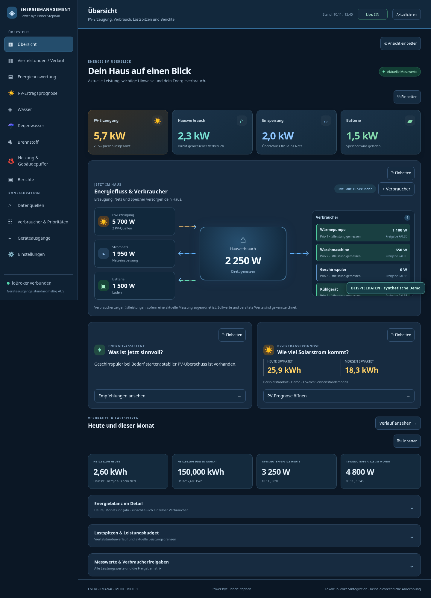

# ioBroker Energiemanagement

[](https://github.com/stephanflug/ioBroker.energiemanagement/actions/workflows/test-and-release.yml)

[Deutsch](README.de.md) · [Installation](docs/en/installation.md) · [User guide](docs/en/user-guide.md) · [Detailed German manual](docs/de/benutzerhandbuch.md) · [Changelog](CHANGELOG.md)

**PV generation, household consumption, demand peaks and optional resource monitoring in one ioBroker interface.** Existing ioBroker data points provide the measurements. The adapter does not depend on a specific meter, inverter, battery, heat pump or consumer brand.

## Download v0.10.2

Version **0.10.2 is a stable release on GitHub**. Download the complete [installable TGZ](https://github.com/stephanflug/ioBroker.energiemanagement/releases/download/v0.10.2/iobroker.energiemanagement-0.10.2.tgz), its [SHA-256 checksum](https://github.com/stephanflug/ioBroker.energiemanagement/releases/download/v0.10.2/iobroker.energiemanagement-0.10.2.tgz.sha256), or the [full project ZIP](https://github.com/stephanflug/ioBroker.energiemanagement/releases/download/v0.10.2/ioBroker.energiemanagement-v0.10.2-projekt.zip). [Release notes and downloads](https://github.com/stephanflug/ioBroker.energiemanagement/releases/tag/v0.10.2) describe this version.

The adapter is not yet published on npm or listed in the official ioBroker repository. Installing a release is a deliberate manual step; the application never installs updates automatically.



*Documentation screenshots contain synthetic demonstration data.*

## Features

| Area | Purpose |
| --- | --- |
| Dashboard | Current PV, household, grid and battery power, energy flow and consumer measurements. |
| Quarter-hour monitoring | Fifteen-minute demand averages, daily/monthly peaks and measurement coverage. |
| Energy analysis | Calendar cards, comparable-day consumption changes, selectable power curves and device detail. |
| PV forecast | Expected production for today/tomorrow, selectable location and multiple roof sections. |
| Water and rainwater | Independent consumption histories; flow and cumulative counter can be assigned together. |
| Fuel | Pellets in kg, oil in l and gas in m³; estimated stock and refill history for pellets/oil. |
| Heating and building buffer | Room sensors, weighted mean temperature, trends, learning model and separately enabled bounded controls. |
| Reports | Selected periods as CSV, JSON or browser print/PDF. |
| Data sources | Central measurement and sensor assignment. |
| Settings | Optional modules, internal or existing database storage and one full-adapter backup. |
| About and licences | Project, developer Stephan Ebner, installed version, full MIT licence and third-party notices. |

Water, rainwater, fuel and heating are hidden by default on a new installation. Physical outputs also start disabled. Enable only the areas needed for your installation.

## Get started

1. Follow the [manual installation guide](docs/en/installation.md). Version 0.10.2 requires **Node.js 22 or newer** and an ioBroker `web` instance.
2. Open the application through the web adapter.
3. Assign grid import power in W and the cumulative import counter in kWh under **Datenquellen** (Data sources).
4. Check live values, units and signs. Add PV, export, battery and optional sensors as available.
5. Add measured devices under **Verbraucher & Prioritäten** and assign their measurement sources centrally.
6. Enable optional modules in Settings and create a full backup after setup.

For an existing instance, install the downloaded release asset through ioBroker's normal package management; do not add a second instance. The detailed guide covers backup and the first installation. If your ioBroker host can reach GitHub, the package URL is:

```bash
iobroker url https://github.com/stephanflug/ioBroker.energiemanagement/releases/download/v0.10.2/iobroker.energiemanagement-0.10.2.tgz
```

Use the **TGZ release asset**, not GitHub's automatically generated “Source code” ZIP/TAR archive, as the installation file.

The application retains its existing German menu labels. The [English user guide](docs/en/user-guide.md) maps those labels to their purpose.

## Documentation

| Task | Guide |
| --- | --- |
| Install or update | [English installation](docs/en/installation.md) · [German installation](docs/de/installation.md) · [Backup and update](docs/de/updates-und-sicherung.md) |
| Configure measurements | [English user guide](docs/en/user-guide.md) · [Central data sources](docs/de/datenquellen.md) |
| Understand the interface | [Detailed German manual](docs/de/benutzerhandbuch.md) · [Screenshot gallery](docs/images/README.md) |
| Diagnose a problem | [Troubleshooting](docs/de/fehlerbehebung.md) · [Report an issue](https://github.com/stephanflug/ioBroker.energiemanagement/issues/new/choose) |
| Review or contribute | [Architecture](docs/de/architektur.md) · [Contributing](CONTRIBUTING.md) · [Tests](docs/reports/test-results-v0.10.2.md) |

## Version information

A compact version indicator remains visible in the header on desktop and mobile. Public GitHub releases are checked on the ioBroker server at startup and approximately every twelve hours; browsers share the server result.

The indicator distinguishes checking, current, update available, unavailable, development build and a neutral state where no public stable release exists. Drafts and prereleases are ignored as update targets. Comparisons use semantic version numbers. Update details include the available version, release date, short notes and release link.

The checker does not install updates or reload the page. Open forms, scroll position and navigation stay in place when version information changes. A failed GitHub request does not stop energy collection. The public 0.10.2 package uses the stable release channel and its GitHub release is a stable update target. If an earlier prepared 0.10.2 development package is installed, install the stable TGZ once through the normal ioBroker package management to replace that build label. The application does not install it automatically.

## Data and calculations

Power in **W/kW** is a current rate; energy in **kWh** is accumulated over time. Device consumption is already part of household consumption and must not be added again. Missing measurements are not treated as zero.

Calendar periods advance automatically without resetting physical meter counters. Same-time day comparisons need sufficiently recorded comparable periods. A newly configured system first collects suitable history. The electricity and consumption archives use Europe/Vienna calendar boundaries, including daylight-saving changes.

Forecasts and tank stock are estimates. PV weather forecasts use Open-Meteo without an API key for private/non-commercial use within the provider terms; a local solar model is also available. See [Open-Meteo terms](https://open-meteo.com/en/terms) and [data attribution](docs/de/architektur.md#netzverkehr-und-datenschutz).

## Backup and database storage

There is **one full-backup and restore function** for the adapter's own settings, assignments, stored archives, comparison profiles, tank data and heating learning data. A restore leaves device and heating controls disabled for review. Foreign sensor objects, other adapters and the entire external database are outside that file.

Internal storage is the default. Optional database archiving uses an existing configured ioBroker database instance while keeping a local copy. Since 0.10.1, complete database checkpoints are compressed into small parts and confirmed by readback. InfluxDB confirmation needs the `getRawEntries` API present in adapter 5.1.8 or a compatible implementation. SQL/history compatibility depends on the provider and is experimental.

## Developer and project

Development: **Stephan Ebner**. Public project contact: [steuerung@gmx.at](mailto:steuerung@gmx.at). Project: [stephanflug/ioBroker.energiemanagement](https://github.com/stephanflug/ioBroker.energiemanagement).

## Installation and project status

- Node.js **22 or newer** for 0.10.2; use an ioBroker-supported LTS release.
- ioBroker js-controller at least 6.0.11 and Admin at least 7.6.20, according to the package metadata.
- A running `web` instance for the browser interface.
- No external database or particular device manufacturer is required.

This stable release is published on GitHub. npm publication and admission to the official ioBroker adapter list remain separate pending steps. Physical load and heating automation are supplementary functions; compatible device interfaces and independent protection remain necessary.

[Installation](docs/en/installation.md) · [User guide](docs/en/user-guide.md) · [German troubleshooting](docs/de/fehlerbehebung.md) · [Contributor guide](CONTRIBUTING.md) · [MIT licence](LICENSE) · [Third-party notices](THIRD_PARTY_NOTICES.md)

## Changelog

### 0.10.2 (stable release)

- Add About and Licenses, a persistent version indicator and server-side public GitHub release checks.
- Keep checks informational, with no automatic installation, control change or page reload.
- Update developer credits, licensing, German/English documentation and publication readiness metadata.
- Supply a complete installable TGZ, project ZIP, checksums and documented tests.

See [CHANGELOG.md](CHANGELOG.md) for the complete history and [v0.10.2 release notes](docs/releases/v0.10.2.md) for downloads and validation.

## License

MIT License

Copyright (c) 2026 Stephan Ebner <steuerung@gmx.at>
Copyright (c) 2026 Energiemanagement contributors <steuerung@gmx.at>

Permission is hereby granted, free of charge, to any person obtaining a copy
of this software and associated documentation files (the "Software"), to deal
in the Software without restriction, including without limitation the rights
to use, copy, modify, merge, publish, distribute, sublicense, and/or sell
copies of the Software, and to permit persons to whom the Software is
furnished to do so, subject to the following conditions:

The above copyright notice and this permission notice shall be included in all
copies or substantial portions of the Software.

THE SOFTWARE IS PROVIDED "AS IS", WITHOUT WARRANTY OF ANY KIND, EXPRESS OR
IMPLIED, INCLUDING BUT NOT LIMITED TO THE WARRANTIES OF MERCHANTABILITY,
FITNESS FOR A PARTICULAR PURPOSE AND NONINFRINGEMENT. IN NO EVENT SHALL THE
AUTHORS OR COPYRIGHT HOLDERS BE LIABLE FOR ANY CLAIM, DAMAGES OR OTHER
LIABILITY, WHETHER IN AN ACTION OF CONTRACT, TORT OR OTHERWISE, ARISING FROM,
OUT OF OR IN CONNECTION WITH THE SOFTWARE OR THE USE OR OTHER DEALINGS IN THE
SOFTWARE.
