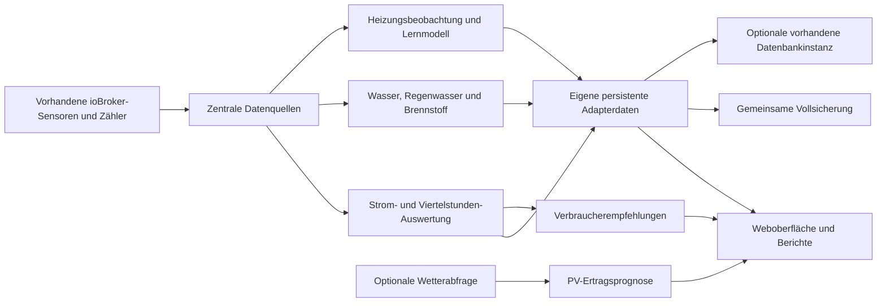

# Architektur und Datenpunkte

[Zur Startseite](../../README.md) · [Benutzerhandbuch](benutzerhandbuch.md) · [Datenquellen](datenquellen.md)

Diese Übersicht erklärt, wie Messungen vom Quelladapter bis zur Anzeige gelangen. Die Einrichtung erfolgt über die Weboberfläche; direkte JSON-Bearbeitung ist für den normalen Betrieb nicht nötig.

## Datenfluss



Die Weboberfläche liest den eigenen Namensraum der ausgewählten Instanz. Sie benötigt keinen permanent geöffneten Browser, damit Messarchive und Lernwerte weitergeführt werden. Eine optionale Datenbank ergänzt die lokalen Daten; sie ist keine Voraussetzung für die grundlegende Aufzeichnung.

## Wichtige Komponenten

| Datei / Modul | Aufgabe |
| --- | --- |
| `main.js` | Adapterstart, Messzyklus, Datenpunktbereitstellung, Nachrichten und Konfigurationsänderungen |
| `lib/engine.js` | Zählerauswertung, Viertelstunden, Tages-/Monatsarchive und Leistungsbudget |
| `lib/insights.js` | Konservative Startempfehlungen und kurzer Leistungsverlauf |
| `lib/consumer-energy.js` | Energieintegration tatsächlicher Geräte-Istleistungen |
| `lib/energy-summary.js` | Kalenderübersicht und getrennte Batterieenergie |
| `lib/day-comparison.js` | Vergleich passender gemessener Tagesabschnitte |
| `lib/utilities.js`, `lib/utilities-service.js` | Getrennte Wasser-, Regenwasser- und Brennstoffverbräuche |
| `lib/fuel-inventory.js` | Bestände, Füllereignisse und Wiederholschutz für Pellets/Öl |
| `lib/heating.js`, `lib/heating-service.js` | Raumzustand, Lernmodell, Heiz-/PV-Empfehlungen und Modulablauf |
| `lib/heating-outputs.js` | Begrenzte eigene Heizungs-Ausgänge und überwachte Rückstellung |
| `lib/forecast.js`, `lib/weather-model.js`, `lib/solar-model.js` | Standortsuche und getrennte PV-Prognose |
| `lib/storage-service.js`, `lib/storage-checkpoint.js` | Optionale Datenbankarchivierung, begrenzte Teilübertragung und Rückleseprüfung |
| `lib/backup.js`, `lib/backup-service.js` | Validierte Vollsicherung und überwachte Wiederherstellung |
| `www/` | Weboberfläche mit Diagrammen, Navigation und Exporten |

## Eigener ioBroker-Namensraum

Im Beispiel wird Instanz 0 verwendet. Weitere Instanzen besitzen denselben Aufbau unter ihrer jeweiligen Instanznummer.

```text
energiemanagement.0
├── config.sources                 Strom-, PV-, Batterie- und Hausquellen
├── config.consumers               Verbraucher, Prioritäten und Ausgänge
├── config.settings                Leistungsziel, Reserve und Qualität
├── config.features_JSON           Sichtbarkeit/Freischaltung optionaler Bereiche
├── config.utilities_JSON          Wasser-, Regenwasser- und Brennstoffquellen
├── config.heating                 Raumfühler, Heizkreise und Heizungsoptionen
├── config.forecast                Standort, PV-Dachflächen und Prognosemethode
├── config.energySummary_JSON       PV-Monatsziel
├── config.storage_JSON            Interne Speicherung oder Datenbankinstanz
├── config.hardwareMaster          Freigabe tatsächlicher Verbraucherbefehle
├── status.*                       Version, Laufzustand und Messqualität
├── live.*                         Aktuelle Werte und gemeinsame Momentaufnahme
├── interval.*                     Aktuelle Viertelstunde
├── day.* / month.*                Aktuelle Kalendersummen und Spitzen
├── control.*                      Budget und berechnete Verbraucherfreigaben
├── consumers.<id>.*               Eigene virtuelle Ausgaben je Verbraucher
├── history.*                      Stromarchive und kurzer Leistungsverlauf
├── analytics.*                    Kalender, Geräteenergie und Tagesvergleich
├── insights.*                     Dynamische Empfehlungen
├── forecast.*                     Prognose, Status und Fehler
├── heating.*                      Raumzustand, Temperaturverlauf und Hinweise
├── utilities.error                Fehler der Wasser-/Brennstoffauswertung
├── storage.status_JSON            Datenbankstatus und geprüfte Zeitpunkte
├── storage.series.*               Kennungen zusätzlicher Datenbankmessreihen
├── storage.checkpointChunks.*     Kennungen komprimierter Sicherungsteile
├── storage.checkpointManifest_JSON Kennung des geprüften Sicherungsmanifests
├── internal.*                     Persistenter interner Zustand und Lernwerte
├── migration.*                    Bericht/Sicherung der speziellen Alt-Migration
└── commands.*                     Eigene Aktionen wie Prognose- oder Lernreset
```

Viele strukturierte Datenpunkte enthalten JSON-Text. Einträge unter `internal.*` dienen dem Adapterbetrieb und sind keine frei editierbaren Tageszähler. Ein unvollständiger oder widersprüchlicher manueller Eingriff kann Auswertung und Wiederherstellung verhindern.

## Erfassung und Datenqualität

Der Standard-Messzyklus beträgt fünf Sekunden und ist in den Admin-Instanzeinstellungen zwischen zwei und 30 Sekunden einstellbar. Ein Modul bewertet die zum Messzeitpunkt vorliegenden Quellen und schreibt seine Ergebnisse in eigene Datenpunkte.

Strom-Viertelstunden verwenden kumulierte Energiezähler und feste 15-Minuten-Grenzen. Geräteenergie, Batterie und Durchflusswerte werden zeitlich integriert; unzulässige Lücken werden nicht überbrückt. Ein Datenpunktwert 0 wird von einer fehlenden Messung unterschieden.

Die Strom-/Verbrauchskalender verwenden **Europe/Vienna**. Zeitumstellungen werden in den tatsächlichen Tageslängen berücksichtigt. Die Wetterprognose verwendet die konfigurierte beziehungsweise vom Dienst gelieferte Standortzeitzone. Das ist bei anderen Standorten und internationalen Installationen zu beachten.

## Aufbewahrung

| Daten | Interne Aufbewahrung in dieser Version |
| --- | --- |
| Strom-Viertelstunden | Bis zu 8.640 abgeschlossene Intervalle |
| Strom-Tagesarchive | Bis zu 450 Kalendertage |
| Strom-Monatsarchive | Bis zu 30 Monate |
| Leistungskurven | Bis zu 48 Stunden mit Minuten-Momentaufnahmen |
| Temperaturkurven | Bis zu 48 Stunden mit Minuten-Momentaufnahmen |
| Batterie-, Wasser-, Regenwasser- und Brennstoff-Tageswerte | Bis zu 450 Kalendertage |
| Tagesvergleichsprofile | Bis zu 35 Tage; bei sehr vielen Reihen begrenzt auf 300.000 erfasste Profil-Viertelstunden |

Momentaufnahmen in kurzen Trends sind keine nachträglich gemittelten Minutenwerte. Die zusätzliche externe Datenbank verwendet ihre eigene Aufbewahrungskonfiguration. Eine Vollsicherung umfasst die aktuell intern vorhandenen eigenen Adapterdaten und ersetzt keinen vollständigen Export externer Datenbankbestände.

## Datenbank und vollständige Sicherungsstände

Im Datenbankmodus sendet der Adapter ungefähr jede Minute gültige numerische Momentaufnahmen. Ein vollständiger aktueller Adapterstand wird etwa stündlich komprimiert und in kleinen Base64-Teilen übertragen. Einzelne Schreibanfragen sind auf höchstens zehn Werte und 64 KiB begrenzt; ein Teil enthält höchstens 16 KiB Base64-Nutzdaten.

Teilkennung, Snapshot-ID, Zeitstempel und Hashes sichern die Zuordnung. Erst nach dem Zurücklesen und Prüfen aller Teile wird das Manifest als vollständiger Stand veröffentlicht und ebenfalls geprüft. Dadurch gelten reine Annahmebestätigungen oder nur teilweise gespeicherte Übertragungen nicht als vollständige Sicherung.

Für InfluxDB verwendet die Rückleseprüfung `getRawEntries`, das tatsächlich aus der Datenbank liest. Dieser Aufruf ist im InfluxDB-Adapter 5.1.8 vorhanden. Andere Versionen benötigen eine kompatible Nachrichtenschnittstelle. Bei `sql` und `history` verwendet die Rückleseprüfung deren `getHistory`-Schnittstelle. Der Betrieb dieser Anbieter ist experimentell und hängt von der konkreten Adapterversion ab. Automatisierte Tests prüfen die Übertragungs- und Bestätigungslogik; sie ersetzen keinen erfolgreichen Verbindungstest mit der eigenen Datenbank.

Die normale gemeinsame Vollsicherung wird unabhängig davon aus den eigenen Adapterdaten erstellt. Datenbank-Sicherungsteile werden nicht rekursiv in sich selbst aufgenommen.

## Empfehlungen und echte Ausgänge

Empfehlungen sind Auswertungsergebnisse. Tatsächliche Ausgänge erfordern zusätzliche Freigaben. Bei der Heizung wird der eigene übernommene Ausgangswert mit seinem Ausgangszustand dokumentiert. Eine bestätigte manuelle Änderung wird nicht als fortbestehender Besitz behandelt.

Eine Wiederherstellung nimmt aktuelle eigene Gerätebefehle zuerst zurück. Erst nach bestätigter Rücknahme werden die eigenen Daten ersetzt. Steuerungsfreigaben bleiben danach aus. So wird eine gespeicherte Konfiguration nicht automatisch als neue physische Gerätefreigabe verwendet.

## Netzverkehr und Datenschutz

- Messquellen und Aktoren werden über die vorhandenen lokalen ioBroker-Adapter angesprochen.
- Die grundlegende Erfassung benötigt keinen externen Cloud-Dienst.
- Die ausdrücklich aktivierte Wetterprognose übermittelt Standortkoordinaten an Open-Meteo. Die Online-Ortssuche übermittelt den Suchtext beim Suchen.
- Das lokale Sonnenstandsmodell verwendet keine Wetterabfrage.
- Datenbank-Zugangsdaten bleiben im eingerichteten Datenbankadapter und werden nicht in der Speicherwahl hinterlegt.
- Eine Vollsicherung kann Standort, Datenpunktzuordnungen, Raum-/Gerätenamen und Verbrauchsverläufe enthalten. Sie gehört nicht in ein öffentliches Fehler-Issue.

Wetterquellen: [Open-Meteo](https://open-meteo.com/), [API-Dokumentation](https://open-meteo.com/en/docs), [Nutzungsbedingungen](https://open-meteo.com/en/terms). Standortsuche basiert auf [GeoNames](https://www.geonames.org/). Open-Meteo-Daten stehen unter [CC BY 4.0](https://creativecommons.org/licenses/by/4.0/); berechnete PV-Erträge sind daraus abgeleitete Schätzungen. Die jeweils geltenden Nutzungsbedingungen und Limits des Dienstes sind zu beachten.
